# PostPilot

**An AI agent that writes, reviews, schedules and publishes social content — with a human approval gate it cannot skip.**

PostPilot is a full-stack social media management app built around one rule: **the AI never publishes anything a person has not explicitly approved.** The agent is genuinely autonomous up to the approval gate — it drafts, validates against real platform limits, optimises per-platform, and scores its own work — and then it stops. Scheduling and publishing unlock only after a recorded human decision on that exact version of the copy.

It runs end to end with **no API keys**: a deterministic content model and a publishing simulator stand in for the LLM and the social APIs, so the entire workflow is demonstrable offline.

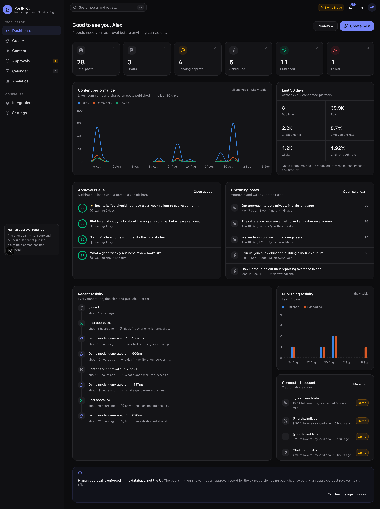

---

## Table of contents

- [The core rule](#the-core-rule)
- [Features](#features)
- [Architecture](#architecture)
- [The agent workflow](#the-agent-workflow)
- [Tech stack](#tech-stack)
- [Folder structure](#folder-structure)
- [Getting started](#getting-started)
- [Environment variables](#environment-variables)
- [Demo mode](#demo-mode)
- [AI provider setup](#ai-provider-setup)
- [OAuth setup](#oauth-setup)
- [Scheduling setup](#scheduling-setup)
- [Testing](#testing)
- [Deployment](#deployment)
- [Screenshots](#screenshots)
- [Security notes](#security-notes)
- [Future improvements](#future-improvements)

---

## The core rule

> **Publishing blocked: human approval is required.**

That message is not a UI convention. The rule is enforced independently in four places, so a bug in any one of them cannot open a hole:

| # | Layer | What it enforces |
|---|---|---|
| 1 | **Status machine** — [`post-status.ts`](src/lib/services/post-status.ts) | The transition table has **no edge** from `DRAFT` or `PENDING_APPROVAL` to `SCHEDULED`. Content can only reach the scheduler by way of `APPROVED`. |
| 2 | **Agent graph** — [`nodes.ts`](src/lib/agent/nodes.ts) | The `human_approval` node calls LangGraph's `interrupt()`. The run is checkpointed to Postgres and halts. Nothing downstream executes until a real decision resumes it. |
| 3 | **Scheduling service** — [`scheduling.ts`](src/lib/services/scheduling.ts) | `schedulePost` refuses any post whose latest approval is missing, negative, or recorded against an older version. |
| 4 | **Publishing engine** — [`publishing.ts`](src/lib/services/publishing.ts) | `assertPublishable` re-checks ownership, approval, version match, account state and schedule validity immediately before dispatch, and writes a `BLOCKED` publishing-log row when it refuses. |

**Approval is bound to a version, not to a post.** Every `Approval` row stores the `postVersion` it was granted against. Editing an approved post bumps the version, drops it back to `DRAFT` and cancels any pending schedule — so a reviewer's sign-off can never be silently applied to different words.

---

## Features

### AI content generation
A full brief — topic, product, audience, platform, content type, tone, length, language, CTA, keywords, hashtags and free-text notes — produces a caption, an optional headline, hashtags, a call to action, an image-generation prompt and a suggested posting time with a rationale.

Post-generation, the AI editor can **improve, shorten, expand, rewrite, change tone or regenerate**, and every change is captured as an immutable revision.

### Human-in-the-loop approval
A dedicated approval queue with post previews, AI quality scores, platform badges, wait times and automation provenance. Reviewers can **approve, approve-and-schedule, request changes, request regeneration, or reject**, always with feedback. Every decision is written to an audit trail showing who decided what, when, and against which version.

### Content library
Full-text search across captions, headlines and hashtags; status, platform and date filters; four sort orders; pagination. Per-post actions for edit, duplicate, delete, submit, schedule, reschedule, cancel, publish-now and retry — each one either enabled or hidden, never a dead button.

### Calendar
Month, week and day views over scheduled, publishing, published and failed posts. Reschedule and cancel inline. Unapproved content simply cannot appear here, because it cannot be scheduled.

### Publishing engine
Atomic job claiming, exponential-backoff retries, idempotency keyed to the post version, per-attempt logging with latency, structured error codes, and post-publish verification. A scheduled post publishes **at most once**, even under concurrent workers.

### Automations
Recurring content workflows (hourly through monthly) that run the same agent on a schedule and drop the result into the approval queue. `requiresApproval` is not a user-facing toggle — the API hard-codes it, and the agent pauses at the same interrupt regardless.

### Analytics
Impressions, reach, likes, comments, shares, clicks, engagement rate and click-through rate; engagement over time, posts and reach by platform, publishing frequency, and a top-performing-content ranking. Every chart ships a legend and an accessible table view.

### Integrations
Four platform adapters (Instagram, LinkedIn, X, Facebook) behind one interface, with an OAuth 2.0 flow, HMAC-signed state, AES-256-GCM token encryption at rest, and per-platform content validation.

---

## Architecture

```
┌──────────────────────────────────────────────────────────────────────┐
│  Next.js App Router                                                   │
│  Server Components read directly · Client Components mutate via REST  │
└───────────────────────────────┬──────────────────────────────────────┘
                                │
┌───────────────────────────────▼──────────────────────────────────────┐
│  API layer            src/app/api/**  ·  withUser() + error mapper    │
│  auth · zod validation · rate limiting · one HTTP shape for errors    │
└───────────────────────────────┬──────────────────────────────────────┘
                                │
┌───────────────────────────────▼──────────────────────────────────────┐
│  Service layer        src/lib/services/**                            │
│  posts · approvals · scheduling · publishing · automation ·          │
│  analytics · integrations · activity        ← all business rules      │
└──────┬────────────────────────┬───────────────────────┬──────────────┘
       │                        │                       │
┌──────▼──────────┐  ┌──────────▼─────────┐  ┌──────────▼─────────────┐
│  Agent layer    │  │  Social layer      │  │  AI layer              │
│  LangGraph      │  │  SocialPlatform    │  │  LLMProvider           │
│  StateGraph +   │  │  Adapter × 4       │  │  mock │ anthropic │    │
│  Prisma         │  │  + demo simulator  │  │  openai-compatible     │
│  checkpointer   │  │                    │  │                        │
└──────┬──────────┘  └──────────┬─────────┘  └────────────────────────┘
       │                        │
┌──────▼────────────────────────▼──────────────────────────────────────┐
│  Data layer           Prisma  ·  PostgreSQL                          │
│  User · SocialAccount · Post · PostRevision · Approval · Schedule ·   │
│  PublishingLog · Automation · AutomationRun · AgentRun ·             │
│  AgentCheckpoint · ActivityLog · Notification · AnalyticsSnapshot     │
└──────────────────────────────────────────────────────────────────────┘
```

**Design decisions worth calling out:**

- **Services own the rules, routes own the HTTP.** Every route is thin: authenticate, validate with Zod, call a service, map errors. The same service functions are called by the agent, the scheduler worker and the test suite, so there is exactly one implementation of each rule.
- **The provider abstraction is genuinely swappable.** `LLMProvider` has one method. The mock, Anthropic and OpenAI-compatible implementations are interchangeable, and nothing upstream — the LangGraph agent included — knows which is active.
- **The demo path is the real path.** Demo publishing runs the same adapter, the same validation, the same error taxonomy and the same logging as live publishing. Only the final network call is simulated.
- **Deterministic checks outrank the model.** The quality gate blends a rule-based structural score (55%) with the model's subjective judgement (45%), and any hard rule violation caps the score at 59 — so a persuasive draft can never talk its way past a platform limit.

---

## The agent workflow

Implemented with **LangGraph** ([`graph.ts`](src/lib/agent/graph.ts)) over a **custom Prisma checkpointer** ([`prisma-checkpointer.ts`](src/lib/agent/prisma-checkpointer.ts)), so a paused run survives a server restart.

```
START
  │
  ▼
parse_request ──────────► sanitise the brief, create the draft row
  │
  ▼
generate_content ───────► LLMProvider.generate()          [AI]
  │
  ▼
validate_content ───────► deterministic platform rules    [RULES]
  │        │
  │        └── hard violations & retries left ──► generate_content
  ▼
optimize_for_platform ──► hashtag budget, link rules,     [RULES]
  │                        X compaction, LinkedIn fold,
  │                        suggested posting slot
  ▼
quality_check ──────────► structural score × model score  [AI]
  │        │
  │        └── below the bar & retries left ────► generate_content
  ▼
human_approval ─────────► interrupt()  ⏸  RUN HALTS HERE  [HUMAN]
  │        │
  │        └── rejected / changes requested ────► END
  ▼
schedule ───────────────► Schedule row, idempotency key
  │        │
  │        └── future slot ─────────────────────► END (handed to the scheduler)
  ▼
publish ────────────────► assertPublishable() → adapter
  │
  ▼
verify_result ──────────► confirm it is actually live
  │
  ▼
END
```

**State channels:** user, brief, content, revisions, quality report, suggested time, approval decision, `approved` flag, schedule, publish result, node history, errors, retry count, timestamps.

The `approved` flag can only be set by the `human_approval` node, and only from a resume payload carrying a real reviewer id. `routeAfterApproval` is the single edge out of the gate.

---

## Tech stack

| Layer | Choice |
|---|---|
| Framework | Next.js 15 (App Router, Server Components, Route Handlers) |
| Language | TypeScript, strict mode, zero `any` in application code |
| UI | React 19, Tailwind CSS v4, Radix UI primitives, Lucide icons, Recharts |
| Agent | LangGraph (`@langchain/langgraph`) with a custom Postgres checkpointer |
| AI | Provider abstraction — deterministic mock, Anthropic Messages API, any OpenAI-compatible endpoint |
| Database | PostgreSQL + Prisma ORM |
| Auth | Auth.js (NextAuth v5), credentials provider, JWT sessions, Prisma adapter |
| Validation | Zod on every API boundary |
| Scheduling | DB-backed job rows, atomic leasing, exponential backoff, in-process loop or external cron |
| Theming | `next-themes`, light/dark/system |

---

## Folder structure

```
prisma/
  schema.prisma           14 models covering the full post lifecycle
  seed.ts                 realistic demo workspace
  seed-data.ts            28 content briefs for a fictional B2B company

scripts/
  worker.ts               standalone scheduler worker
  test-flow.ts            end-to-end workflow test (services, DB, agent)
  test-api.mjs            end-to-end API test (HTTP, auth, validation)

src/
  app/
    (auth)/               login, register
    (app)/                dashboard, create, content, approvals, calendar,
                          analytics, integrations, settings
    api/                  REST endpoints
  components/
    ui/                   design-system primitives
    layout/               sidebar, topbar, command palette, notifications
    charts/               chart kit + engagement/activity/breakdown charts
    content/              preview, quality report, agent trace, actions
    approvals/            review dialog
    dashboard/            stat cards, activity feed, queue previews
  lib/
    agent/                LangGraph: state, nodes, graph, runner, checkpointer
    ai/                   provider interface, mock engine, real providers,
                          prompts, schemas, deterministic validators
    social/               adapter interface, base adapter, 4 platform adapters
    services/             posts, approvals, scheduling, publishing,
                          automation, analytics, integrations, activity
    security/             AES-256-GCM crypto, sanitisation, rate limiting
    validation/           Zod schemas
    constants/            platform specs, labels
    api/                  route wrapper + typed fetch client
```

---

## Getting started

### Prerequisites

- Node.js 20+ (22 or 24 recommended)
- PostgreSQL 14+ running locally

### Setup

```bash
# 1. Install
npm install

# 2. Configure — the defaults work out of the box for local development
cp .env.example .env
#    edit DATABASE_URL to point at your Postgres instance

# 3. Create the database
createdb postpilot_dev

# 4. Generate the client, push the schema and seed the demo workspace
npm run setup

# 5. Run
npm run dev
```

Open <http://localhost:3000> and sign in:

```
demo@postpilot.app  /  demo1234
```

The seeded workspace has 28 posts across every lifecycle state, 4 connected demo accounts, 3 automations, publishing logs, approval history and 30 days of analytics — so every screen has something meaningful on it immediately.

### Scripts

| Command | What it does |
|---|---|
| `npm run dev` | Development server |
| `npm run build` / `npm start` | Production build and serve |
| `npm run setup` | `prisma generate` + `db push` + `db seed` |
| `npm run db:seed` | Re-seed the demo workspace |
| `npm run db:studio` | Prisma Studio |
| `npm run typecheck` | `tsc --noEmit` |
| `npm run worker` | Standalone scheduler worker |
| `npm run test:flow` | End-to-end workflow test (no server needed) |
| `npm run test:api` | End-to-end API test (needs `npm run dev`) |

---

## Environment variables

Everything is documented in [`.env.example`](.env.example). The essentials:

| Variable | Required | Purpose |
|---|---|---|
| `DATABASE_URL` | ✅ | PostgreSQL connection string |
| `AUTH_SECRET` | ✅ | Auth.js session signing (min 16 chars) |
| `ENCRYPTION_KEY` | ✅ | 64 hex chars for AES-256-GCM token encryption — `openssl rand -hex 32` |
| `AI_PROVIDER` | — | `mock` (default), `anthropic` or `openai` |
| `ANTHROPIC_API_KEY` / `ANTHROPIC_MODEL` | — | Anthropic credentials; model defaults to `claude-opus-5` |
| `OPENAI_API_KEY` / `OPENAI_MODEL` / `OPENAI_BASE_URL` | — | Any OpenAI-compatible endpoint |
| `DEMO_MODE` | — | `true` (default) simulates publishing |
| `DEMO_PUBLISH_FAILURE_RATE` | — | 0–1, share of simulated publishes that fail (default `0.08`) |
| `CRON_SECRET` | — | Bearer token for `POST /api/cron/tick` |
| `ENABLE_IN_PROCESS_SCHEDULER` | — | `true` runs the scheduler inside Next.js (local convenience) |
| `SCHEDULER_INTERVAL_MS` | — | Tick interval, default 20000 |
| `*_CLIENT_ID` / `*_CLIENT_SECRET` | — | Per-platform OAuth credentials |

Environment parsing is centralised and validated with Zod in [`env.ts`](src/lib/env.ts) — a missing or malformed value fails fast with a readable message rather than surfacing as a runtime `undefined`.

---

## Demo mode

Demo mode is what makes this runnable by anyone, immediately. It is **on by default** and covers three things:

**1. AI generation.** With no provider key, `getProvider()` returns the `MockProvider`, backed by a compositional copy engine ([`copy-engine.ts`](src/lib/ai/mock/copy-engine.ts)). It is seeded from the brief, so the same brief produces the same post and "regenerate" produces a genuinely different one. It respects platform limits, tone, content type, length, keywords and hashtags — the output is good enough that the rest of the product is worth demonstrating.

**2. Social connections.** Without OAuth credentials, connecting a platform provisions a simulated account flagged `isDemo`, clearly badged throughout the UI.

**3. Publishing.** The demo simulator runs behind the *same* adapter as live publishing: content is validated against each platform's real character and hashtag limits, and a tunable share of attempts fail with a retryable 503 so the retry, failure and recovery paths are demonstrable rather than theoretical. External ids are derived from the idempotency key, so a duplicate call produces the same id.

Demo mode is surfaced prominently in the top bar, on `/create`, `/integrations`, `/analytics` and `/settings` — a reviewer should never be unsure whether a post actually went out.

---

## AI provider setup

```bash
# Anthropic
AI_PROVIDER="anthropic"
ANTHROPIC_API_KEY="sk-ant-..."
ANTHROPIC_MODEL="claude-opus-5"

# Or any OpenAI-compatible endpoint (OpenAI, Groq, Together, Ollama, …)
AI_PROVIDER="openai"
OPENAI_API_KEY="sk-..."
OPENAI_MODEL="gpt-4o-mini"
OPENAI_BASE_URL="https://api.openai.com/v1"
```

Both real providers use **structured outputs** (a JSON Schema handed to the model), and the response is re-validated with Zod before it is trusted. If the configured provider has no key, the app silently falls back to the mock rather than breaking — a missing key degrades the product, it never breaks it.

API keys are read in exactly one place, on the server, and never reach the browser.

---

## OAuth setup

Each platform needs a client id and secret in the environment. The redirect URI is:

```
{OAUTH_REDIRECT_BASE_URL}/api/integrations/{platform}/callback
```

for example `http://localhost:3000/api/integrations/linkedin/callback`.

| Platform | Where to register | Scopes requested |
|---|---|---|
| LinkedIn | LinkedIn Developer Portal | `openid profile email w_member_social` |
| X | X Developer Portal (OAuth 2.0) | `tweet.read tweet.write users.read offline.access` |
| Facebook | Meta for Developers | `pages_manage_posts pages_read_engagement pages_show_list` |
| Instagram | Meta for Developers (Business/Creator) | `instagram_business_basic instagram_business_content_publish` |

Set `DEMO_MODE="false"` to use real credentials. With credentials present and demo mode off, "Connect" opens the platform's consent screen; otherwise it provisions a demo account.

**The `state` parameter is HMAC-signed** and carries the user id and an issue time, so the callback is verified statelessly, cannot be forged, and expires after 10 minutes. Tokens are encrypted with AES-256-GCM before being written and are decrypted only inside an adapter.

---

## Scheduling setup

Three deployment shapes, all driving the identical publishing service:

**1. In-process (default, local).** `ENABLE_IN_PROCESS_SCHEDULER=true` starts a loop inside the Next.js server. Zero setup — scheduled posts just publish.

**2. External cron (recommended in production).**

```bash
ENABLE_IN_PROCESS_SCHEDULER=false
CRON_SECRET="a-long-random-string"
```

```bash
curl -X POST https://your-app/api/cron/tick \
  -H "Authorization: Bearer $CRON_SECRET"
```

On Vercel, `vercel.json`:

```json
{ "crons": [{ "path": "/api/cron/tick", "schedule": "* * * * *" }] }
```

**3. Standalone worker.** `npm run worker` runs the same tick loop in its own process — the right shape for a container or a systemd unit.

**Concurrency safety.** A tick claims each job with a conditional `UPDATE ... WHERE status IN (PENDING, QUEUED, FAILED)`, so only one worker can ever move a schedule into `PUBLISHING`. A second caller gets `SKIPPED_DUPLICATE`, which is logged rather than silently swallowed. Failures retry with backoff (2m → 10m → 30m) up to `maxAttempts`; a post that exhausts its retries lands in `FAILED` and can be retried by hand without needing re-approval, because the content never changed.

---

## Testing

Two suites, both exercising the real database and the real agent — no mocking beyond what the product itself ships.

```bash
npm run test:flow   # 73 assertions — services, agent, publishing engine
npm run test:api    # 30 assertions — HTTP, auth, validation (needs a dev server)
```

**`test:flow`** covers the complete happy path (generate → validate → optimise → score → submit → edit → approve → schedule → scheduler tick → publish → verify → logs → dashboard stats) plus:

- publishing an unapproved post is blocked with the canonical message
- rejection permanently blocks publishing *and* scheduling
- regeneration after "changes requested"
- **editing after approval revokes it** — version bump, back to draft, schedule cancelled, stale approval rejected
- missing social account, and disconnecting an account with pending posts
- invalid schedules (past, and beyond 12 months)
- publish failure → retry with backoff → terminal failure → recovery
- platform validation rejecting content that cannot be published (over-length X post)
- AI provider outage surfacing as a clean error, then recovering
- cross-user authorisation on publish, schedule, edit and approve
- duplicate publishing attempts producing exactly one successful publish

**`test:api`** covers the same lifecycle over HTTP, plus unauthenticated access, cron secret verification, malformed JSON, and invalid enum values.

---

## Deployment

**Vercel** (or any Node host):

1. Provision PostgreSQL (Neon, Supabase, RDS, …) and set `DATABASE_URL`.
2. Set `AUTH_SECRET`, `ENCRYPTION_KEY`, `NEXTAUTH_URL` and `OAUTH_REDIRECT_BASE_URL`.
3. Set `ENABLE_IN_PROCESS_SCHEDULER=false` and configure a cron hitting `/api/cron/tick`.
4. Set `DEMO_MODE=false` and add platform credentials if you want real publishing.
5. Deploy. `npm run build` runs `prisma generate` first.
6. Apply the schema once with `npx prisma migrate deploy` (or `db push` for a throwaway environment).

`serverExternalPackages` is configured for `@prisma/client` and `bcryptjs`. The build produces no static pages for authenticated routes — everything user-scoped is rendered on demand.

---

## Screenshots

| Dashboard | Content generator |
|---|---|
|  | 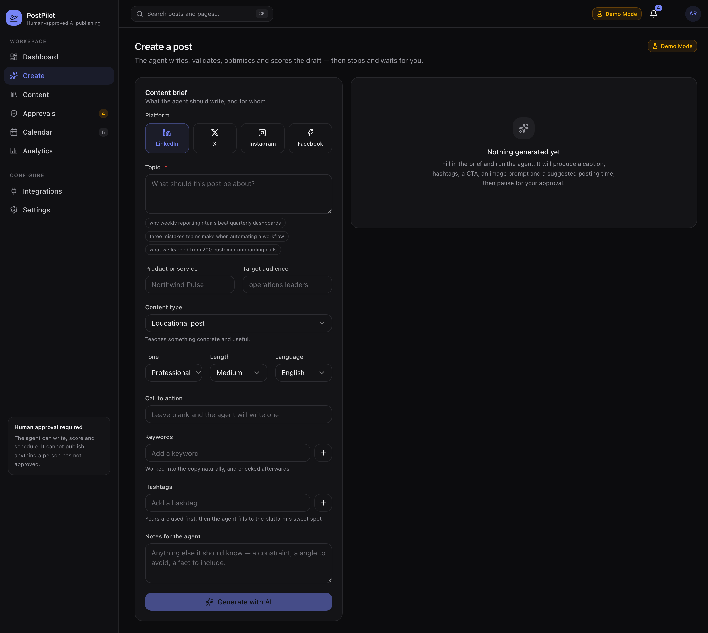 |

| Approval queue | Content library |
|---|---|
| 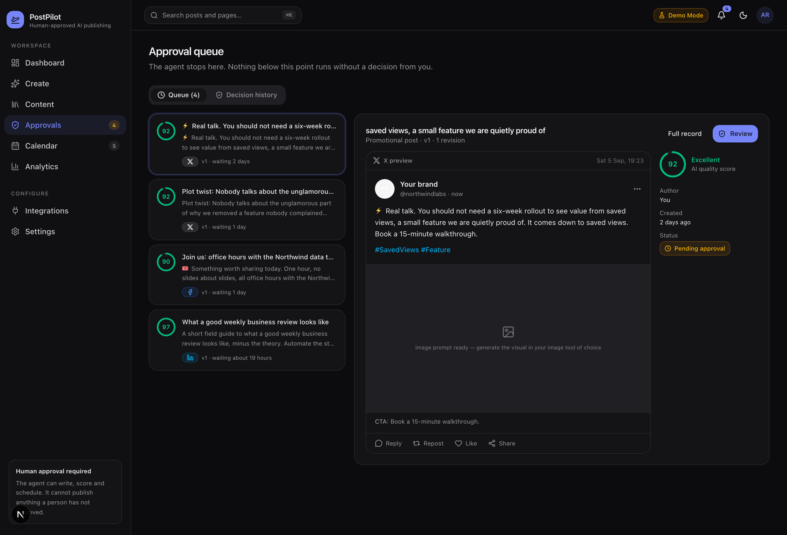 | 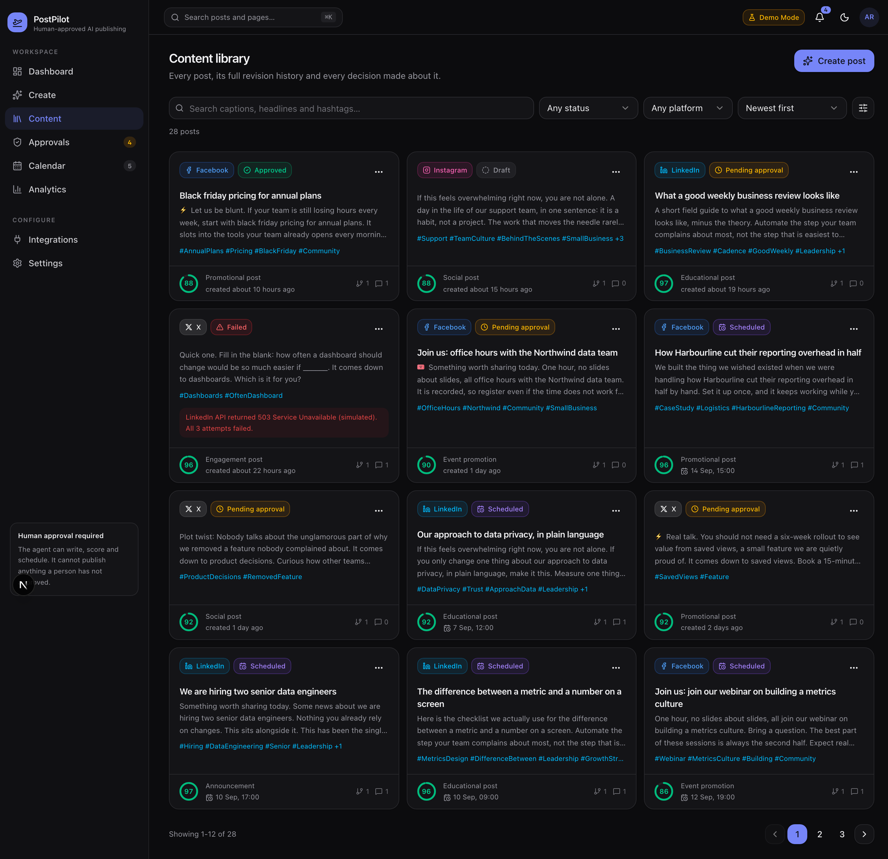 |

| Calendar | Analytics |
|---|---|
| 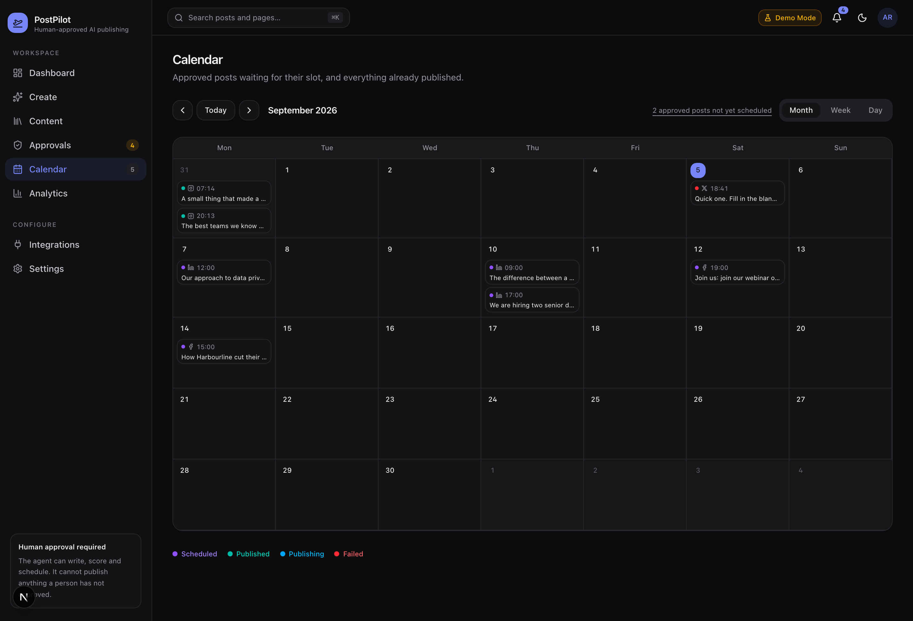 | 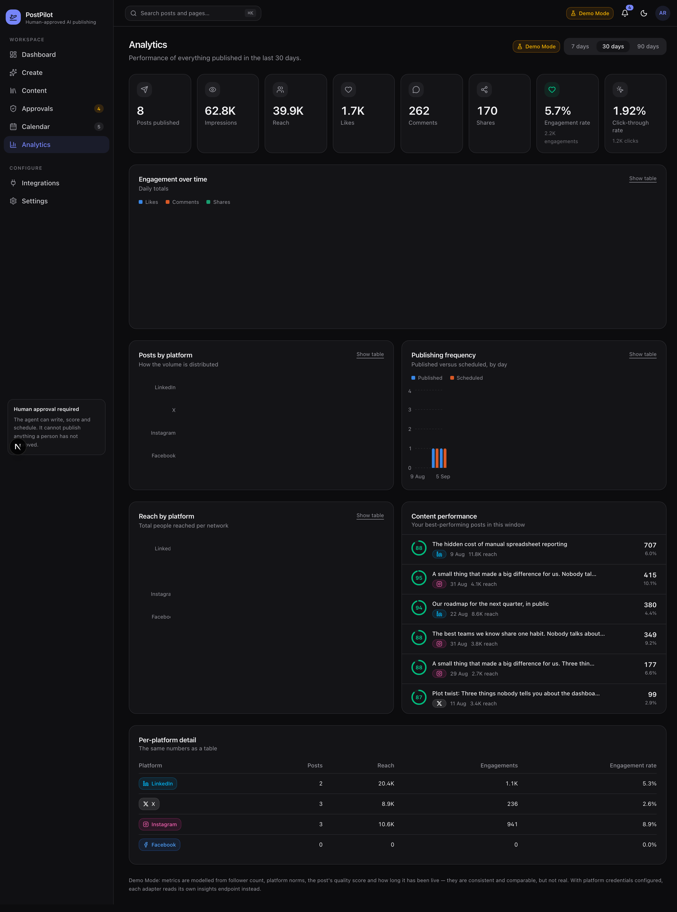 |

| Integrations | Settings & automations |
|---|---|
| 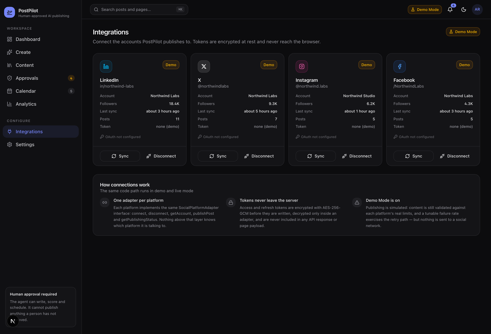 | 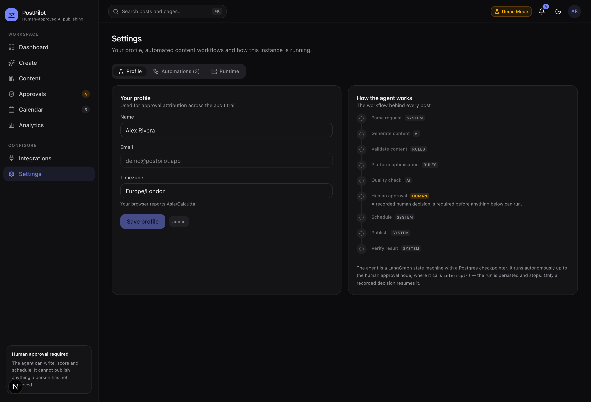 |

**Light theme and responsive layouts** — the theme is token-driven (`next-themes` + CSS custom properties), and every screen is built mobile-first:

| Light theme | Tablet | Mobile |
|---|---|---|
| 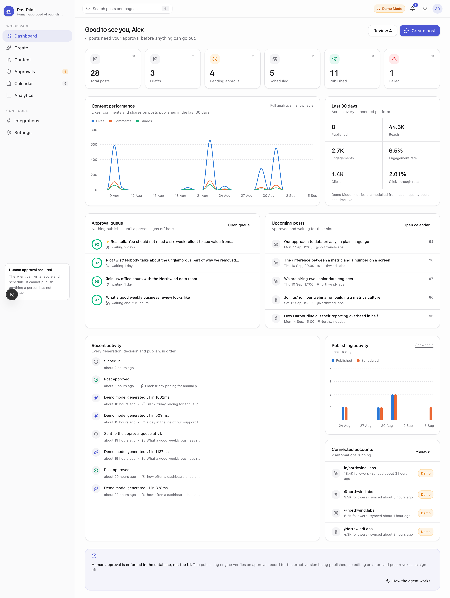 | 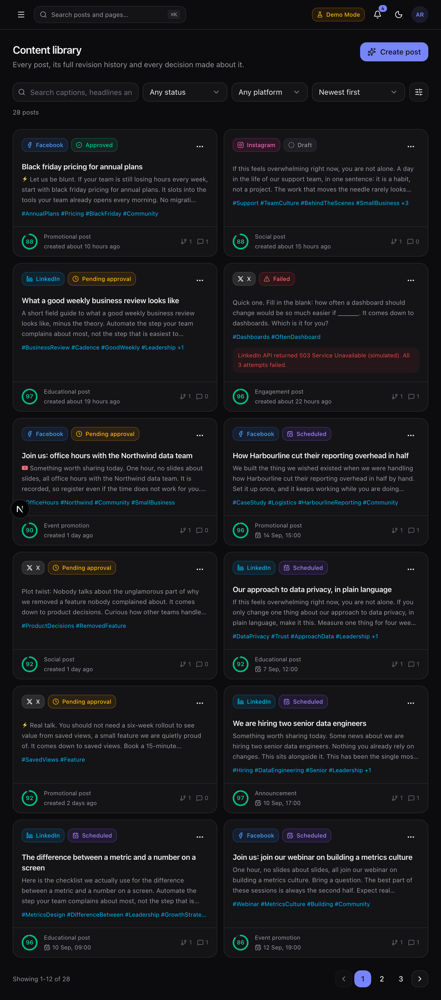 | 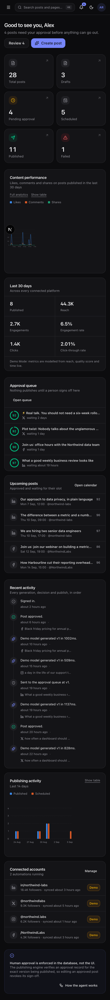 |

---

## Security notes

- **Secrets stay server-side.** API keys and OAuth tokens are read in one module each, never serialised into a page payload or an API response. `publicRuntimeFlags()` is an explicit whitelist of what the client may know.
- **Tokens encrypted at rest.** AES-256-GCM with a versioned envelope (`v1.<iv>.<tag>.<ciphertext>`), decrypted only inside a platform adapter.
- **Every input validated.** Zod schemas on every route; malformed JSON returns 422, not 500.
- **Every mutation authorised.** `withUser()` wraps each route, and every service re-checks ownership rather than trusting the caller.
- **Content sanitised.** Control characters, zero-width and bidi-override code points are stripped from all AI- and user-generated copy; post bodies are rendered as text nodes, never `dangerouslySetInnerHTML`.
- **Constant-time secret comparison** for the cron token and OAuth state signature.
- **Rate limiting** on generation, refinement and registration.
- **Duplicate publishing structurally prevented** by a unique idempotency key plus atomic job claiming.

---

## Future improvements

- **Multi-tenant workspaces** with roles, so the reviewer and the author are genuinely different people (the approval trail is already attributable — only the membership model is missing).
- **Real image generation** wired to the image prompt the agent already writes.
- **Redis-backed rate limiting and job queue** to replace the in-memory limiter and the DB-polling scheduler at scale.
- **Streaming generation**, so long posts appear token by token instead of after a spinner.
- **A/B hook testing** — generate two openers, publish both to a slice, promote the winner.
- **Comment and DM triage**, closing the loop from publishing to engagement.
- **Per-brand voice profiles** learned from a corpus of approved posts and injected into the system prompt.
- **Webhook delivery** for publish and failure events, so downstream systems can react.

---

Built as a portfolio project demonstrating AI agents, LangGraph, human-in-the-loop workflows, LLM integration, OAuth, REST API design, background jobs, cron automation, database design, authentication, authorisation and system architecture.
